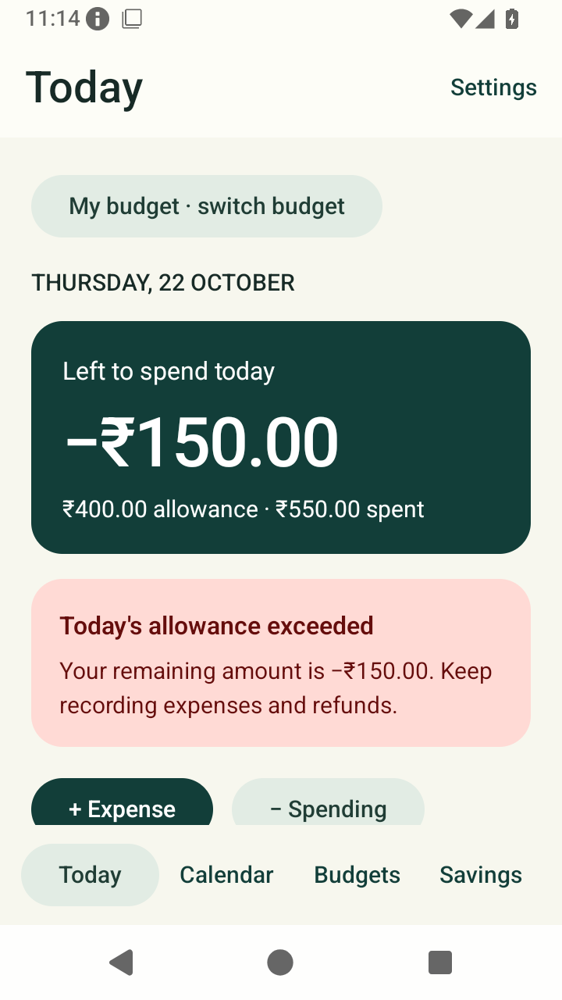
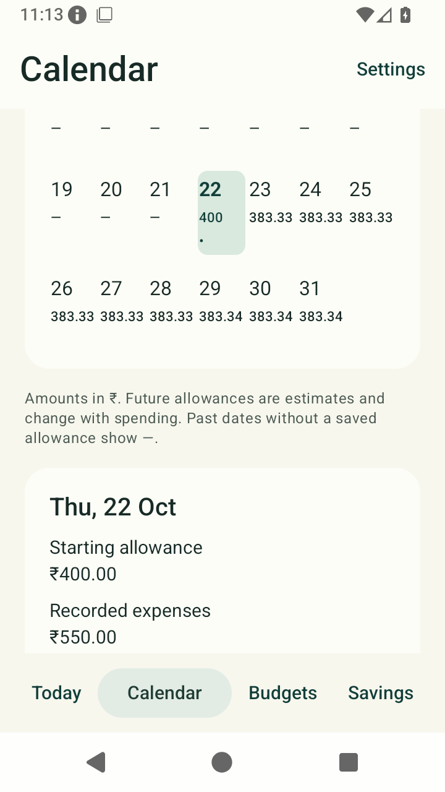
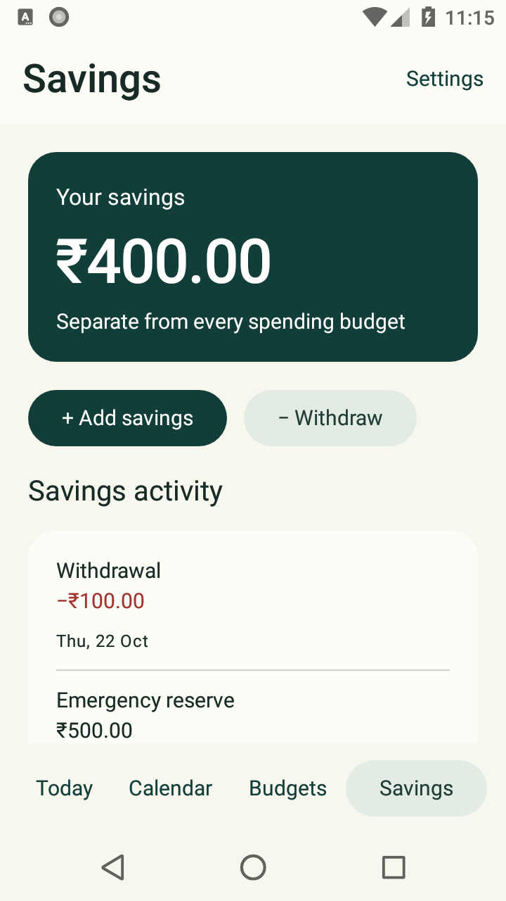

# Daily Budget Manager

**DayBudget** is a local Android app for daily spending, several monthly budgets, and separate savings. It tracks recorded amounts; it does not hold money or connect to a bank.

## Download

**[Download DayBudget 0.2 APK](https://github.com/souravsamaddar77-eng/daily-budget-manager/releases/download/v0.2.0/DayBudget-debug.apk)** · [SHA-256 checksum](https://github.com/souravsamaddar77-eng/daily-budget-manager/releases/download/v0.2.0/DayBudget-debug.apk.sha256) · [Release notes](https://github.com/souravsamaddar77-eng/daily-budget-manager/releases/tag/v0.2.0)

Open the APK link directly on your Android phone. This is a 13 MB debug build for Android 8/API 26 or later, including Android 16. Android may ask you to allow installation from the browser or file app used to open it.

The app uses `dev.daybudget.debug`. Installing this update over the preceding DayBudget debug build preserves records when Android accepts the same signing certificate. **Do not uninstall the old app to update it:** uninstalling removes local records. Installation on a phone is your manual action; development testing uses emulators.

## Features

- **Today:** a frozen daily allowance, expenses, refunds, and monthly balance. Use **+ Expense** for a purchase and **− Spending** for money returned. Correct mistakes in Transactions.
- **Budgets:** independent named budgets, each with its own monthly amounts, timezone, entries, and snapshots. Switching budgets does not move entries.
- **Calendar:** select a date to see recorded spending and its allowance. Past allowances appear only when a snapshot exists; future amounts are labelled estimates.
- **Monthly names:** rename each monthly record, such as “October essentials”.
- **Savings:** deposits and withdrawals in a separate ledger, excluded from every spending budget. Withdrawals cannot exceed recorded savings.
- **Appearance:** Light, Dark, or Use system theme. Large text uses a day list in the calendar and scrollable forms.
- **Notifications:** optional expense/merchant updates and overspend alerts with an alarm tone, subject to Android permissions, channel settings, volume, and Do Not Disturb.
- **UPI detection:** optional local parsing of selected PhonePe, Google Pay, and Paytm notifications. Clear supported English outgoing-payment patterns can be added to one chosen budget. Uncertain extracted payments wait for review. Coverage is experimental and does not represent complete payment history.

The [interactive Figma prototype](https://www.figma.com/design/OIAixn8WwL74na1NNcYmoo?node-id=5-25) includes Today, Calendar, Budgets, Savings, Settings, dark mode, payment review, and entry forms. The Android interface uses native Compose screens adapted from those designs.

## Screenshots

Native emulator captures with synthetic balances. More screenshots and test details are in [validation](docs/VALIDATION.md).

<p>
  
  
  
</p>

## Using DayBudget

Enter the spending money left **from now until month-end**. Earlier purchases are already reflected in that opening amount. A usual monthly amount is optional and separate from the initial partial month. Record purchases as they happen; merchant, category, and note are optional. Transfers between your own accounts and cash withdrawals are not purchases.

Create more budgets from Budgets. Do not put the same purchase in several budgets unless intentionally splitting its amount. Savings records money reserved outside those budgets; entering savings does not transfer money.

Monthly remaining is opening funds plus adjustments minus included expenses plus included refunds. Today's allowance is frozen when that budgeting date first opens. Spending changes today's remainder immediately; tomorrow uses the latest monthly balance. Missed days do not consume money, and unused allowance is not added twice.

For example, ₹4,000 entered on 22 October covers ten dates, giving a ₹400 daily allowance. A ₹200 expense and ₹40 refund leave ₹240 today and ₹3,840 this month. All calculations use integer paise.

Use refunds for money actually returned. Edit an incorrect purchase amount in Transactions. Linked refunds cannot exceed the remaining refundable purchase amount. Cross-month and tracking-boundary changes show a preview. Manual future expenses are rejected. Monthly adjustments preserve today's allowance. Surplus/deficit does not carry forward automatically.

## Optional notification access

Open Settings → Set up UPI detection. Read the explanation, grant Android notification access, return, choose apps and a destination budget, then enable detection and save. Automatic recording is a separate choice. Capture and spending alerts start off.

Android notification access is broad. DayBudget filters selected packages before reading text, parses locally, and stores only extracted payment details and duplicate-detection metadata. It does not keep raw notification text, OTPs, account numbers, or UPI addresses. No Internet or SMS permission is requested.

Changed templates, unsupported languages, redacted content, disabled notifications, or missed notices can prevent detection. Synthetic tests check parsing/import behavior; they do not certify every payment-app version. Review your entries and add missing purchases manually. Enabling access does not fetch history. See [notification behavior and limits](docs/NOTIFICATIONS.md).

## Data and privacy

Records stay in app-private Room databases and local preferences. There is no account, backend, advertising, analytics, or payment initiation. Room does not itself encrypt databases. Financial records and capture metadata are excluded from Android backup rules.

There is **no export or restore yet**. Uninstalling, clearing data, losing the device, or choosing Delete all local data can permanently lose all records.

The v0.1 ledger is adopted in place. An explicit tested schema migration adds import receipts while preserving settings, entries, adjustments, snapshots, and undo. Unknown schema versions fail rather than erase data.

## Build and test

See [toolchain](docs/TOOLCHAIN.md) for pinned versions. Provide a compatible JDK, SDK platform `platforms;android-37.0`, and Build Tools 37.0.0. Set `ANDROID_HOME` or use an untracked `local.properties` for the SDK location. Compile/target API is 37; minimum API is 26.

```powershell
.\gradlew.bat testDebugUnitTest lintDebug lintRelease assembleDebug assembleDebugAndroidTest --console=plain --max-workers=2
python .\scripts\source-audit.py
```

The wrapper and dependencies download on first use. APK output: `app/build/outputs/apk/debug/app-debug.apk`. Local builds use your own debug signing key and normally cannot replace a downloaded APK signed with another key.

Tests cover arithmetic, dates, refunds, migration, budget isolation, savings, notification parsing, duplicate imports, crash recovery, and UI flows. Host tests share Android tests through Robolectric. See [validation](docs/VALIDATION.md) for current results, screenshots, APK hash, and limitations, and [architecture](docs/ARCHITECTURE.md) for storage behavior. The repository contains source and synthetic fixtures, not personal financial records or signing keys.
